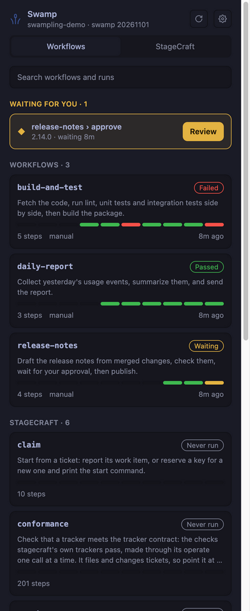
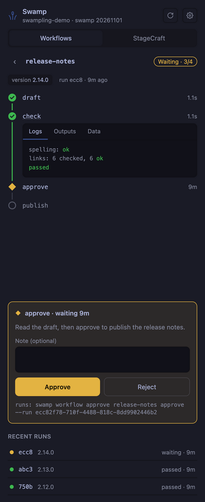
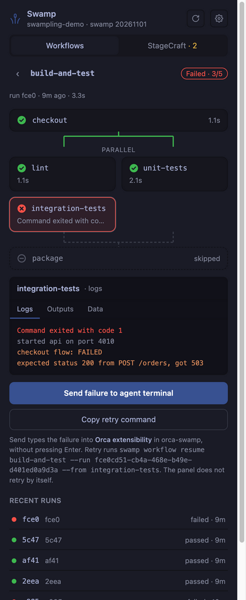
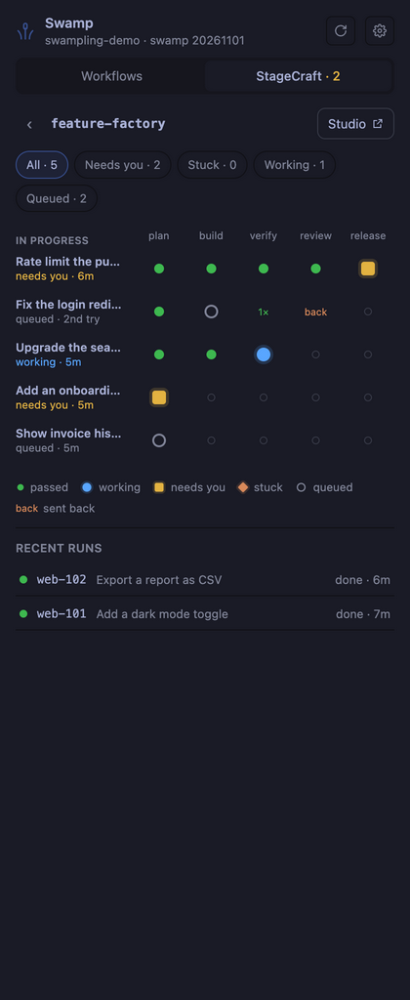
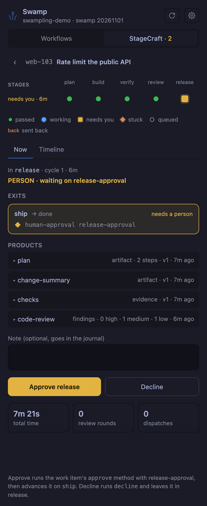
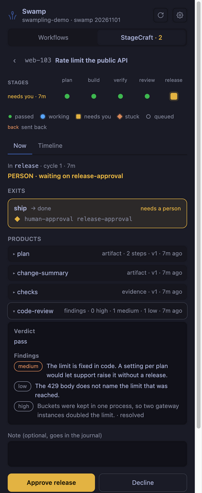

# Swampling

See your [swamp](https://swamp-club.com) workflows and StageCraft factories in an [Orca](https://github.com/stablyai/orca) side panel. Watch runs as they happen, read their logs, approve what waits on you, and hand a failure to your agent.

| Workflows | A run that waits for approval | A failed parallel run |
|---|---|---|
|  |  |  |

| StageCraft factory grid | A ticket that waits for you | The review a ticket produced |
|---|---|---|
|  |  |  |

The screenshots use a demo repo with invented data.

## What it does

**Workflows tab**
- Lists your repo's own workflows first, then the workflows that come with each extension, such as StageCraft.
- Opens a workflow on its latest run, with that workflow's recent runs below it.
- Shows each run's steps, including parallel steps, with their logs, outputs and data.
- Approves or rejects a step that waits for approval. After an approval, the run continues by itself.
- Sends a failed run to an agent terminal in your workspace, or copies the command to retry it.

**StageCraft tab** (when the repo has the `@swamp/stagecraft` extension)
- Lists your factories, with a bar of each factory's latest tickets and how many need you.
- Opens a factory as a grid: one row per ticket, one column per stage. It shows where each ticket is now, what it already passed, and what sent it back.
- Filters tickets by status: needs you, stuck, working or queued. Finished tickets are under Recent runs.
- Opens a ticket to show its path, its timeline and what it produced. You can approve or decline what waits on you.
- Opens the StageCraft studio in your browser.

**Everywhere**
- Finds the swamp repo of the Orca workspace you are in. Pick another repo, and the panel remembers it for that workspace.
- Works with repos on remote hosts over SSH.
- Has themes, including Swamp and Swamp Club.

## What you need

- Orca 1.4.246 or later.
- The swamp CLI on the machine that holds the repo. The panel looks in `~/.local/bin/swamp` first, then on your `PATH`.
- For the StageCraft tab: the StageCraft extension in that repo (`swamp extension pull @swamp/stagecraft`).
- For remote repos: SSH access to the host with a key, without a password prompt. Orca's SSH host setup is enough.

## Install

```sh
orca plugin install coffeepy/orca-swamp
```

Orca shows the access the plugin asks for (below) and the command to approve it. Then open the panel from Orca's right sidebar.

## Access it asks for

The plugin runs code, so Orca asks you to approve it before it installs.

| Access | Why |
|---|---|
| Runs a worker process on your machine | The worker runs `swamp` commands, and `ssh` for remote repos. The panel itself has no network access. |
| `workspace:read` | Finds the focused workspace, its folder and its terminals, so the panel shows the right repo. |
| `terminal:send` | Types the failure summary into your agent's terminal when you press "Send failure to agent terminal". |

The plugin changes your swamp repo only when you press a button. Approve, reject and resume a workflow run; approve or decline a ticket; and start the studio. Everything else only reads.

It writes its own settings to `~/.config/orca-swamp/`: the repo you picked for each workspace, your theme, and SSH connection sockets.

## Troubleshooting

- **"swamp is not installed".** Install swamp on that machine so it is in `~/.local/bin` or on your `PATH`, then press Refresh.
- **A remote repo does not load.** The panel shows the exact `ssh` command it tried. Run it in a terminal. If it asks for a password or to trust a host key, fix that first.
- **The wrong repo shows.** Use the repo picker in the panel header. The pick applies to the current workspace only.
- **The StageCraft tab says the extension is missing.** Run `swamp extension pull @swamp/stagecraft` in the repo.
- **Plugin logs.** Run `orca plugin logs <plugin id>`. Run `orca plugin list` to find the id.

## Develop

See [docs/architecture.md](docs/architecture.md) for how the plugin works, and how to load and test it from a folder.

## License

MIT. See [LICENSE](LICENSE).
